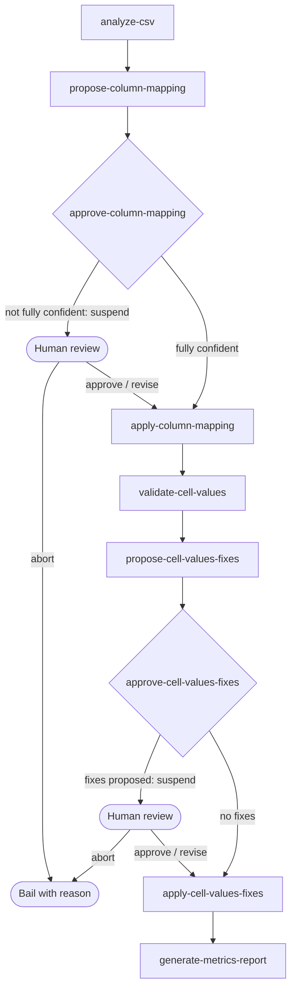

# CSV Mapping & Validation Workflow

[](https://github.com/melnikkk/csv-field-mapper/actions/workflows/ci.yml)

A Mastra workflow that accepts an arbitrary CSV, maps its columns to a known template, suspends for human confirmation when mappings are not fully confident, validates every cell, proposes AI-assisted fixes for cells that fail validation, and suspends again for human approval before writing the final output.

After each run a JSON metrics report is written alongside the output CSV and three Mastra scorers (mapping accuracy, efficiency, HITL burden) persist scores to the database, providing the foundation for a fair comparison with a future agent implementation.

<!-- TODO: Studio suspend/resume GIF -->

## Quickstart

Requires Node.js `>=22.13.0` (see `engines.node` in `package.json`) and [Bun](https://bun.sh) as the package manager and script runner.

```shell
bun install
cp .env.example .env
# set GOOGLE_GENERATIVE_AI_API_KEY in .env

bun run demo
```

`bun run demo` (`scripts/demo.ts`) runs the workflow on `samples/products.csv` with `samples/templates/products.json`, prints each suspend payload, auto-approves it, and prints the final result.

To drive the workflow interactively, run `bun run dev` and open [http://localhost:4111](http://localhost:4111) for Mastra Studio.

| Script              | Purpose                            |
| ------------------- | ---------------------------------- |
| `bun run dev`       | Start Mastra Studio                |
| `bun run build`     | Build a production server          |
| `bun run demo`      | End-to-end run on the sample CSV   |
| `bun run test`      | Unit tests (`bun test --isolate`)  |
| `bun run lint`      | oxlint                             |
| `bun run fmt:check` | oxfmt check (`bun run fmt` to fix) |
| `bun run typecheck` | `tsc --noEmit`                     |

## Design decisions

**Workflow, not agent.** The execution path is deterministic: parse, map, [suspend], apply, validate, propose fixes, [suspend], write, report. The LLM is invoked at exactly two points (fuzzy column matching and cell fix suggestions), so no dynamic tool selection is needed. A workflow gives reproducible runs, typed step boundaries, and cheap, comparable metrics.

**Alias dictionary first, LLM fallback second.** Known synonyms resolve instantly and for free from the template's `aliasDictionary`. Only headers the dictionary cannot resolve go to Gemini Flash, which keeps token spend and nondeterminism limited to the genuinely ambiguous columns.

**Human-in-the-loop at two points.** Column mapping and cell fixes are the two places where a wrong guess silently corrupts data. The workflow suspends there only when needed: the mapping step skips suspension when every mapping is fully confident, and the fixes step skips it when there is nothing to review. Both support `approve`, `revise`, and `abort`.

## Workflow flow



## Workflow steps

**`analyze-csv`**: Resolves `filePath` (symlinks followed) and bails if it is not an existing file inside the allowed input directory (see Workflow Input). Then reads the CSV, bails on empty files, files over `maxFileSize` and non-UTF-8 content, and extracts the header row, a sample of data rows, and the total row count.

**`propose-column-mapping`**: Alias dictionary lookup, then Gemini Flash for any headers still unresolved.

**`approve-column-mapping`** (suspend point 1): If any mapping is not fully confident, suspends and presents the proposed mappings. Resume actions: `approve`, `revise` (supply `correctedMappings`; the workflow continues with them and does not suspend again), or `abort`.

**`apply-column-mapping`**: Aborts with a descriptive message if any `required: true` template column has no mapped CSV header. Otherwise rewrites the CSV with template-aligned headers into an intermediate file. Unmapped non-required columns are dropped.

**`validate-cell-values`**: Runs the per-cell validators of each template column. Cells that fail but can be fixed via `fixerStrategy` are corrected in place and recorded in `autoFixed`; remaining failures are `needs-review`.

**`propose-cell-values-fixes`**: Calls Gemini Flash to suggest corrected values for `needs-review` cells. With no such cells, no LLM call is made.

**`approve-cell-values-fixes`** (suspend point 2): If fixes were proposed, suspends and presents `proposedFixes` together with `autoFixed`. Resume actions: `approve`, `revise` (supply `correctedFixes`; no further suspension), or `abort`.

**`apply-cell-values-fixes`**: Applies approved fixes by row index and column name and writes the final CSV. Steps never delete their input files, so they are safe to retry.

**`generate-metrics-report`**: Assembles `RunMetrics`, runs the three scorers, and writes `csv-mapper-metrics-<runId>.json`, then deletes the intermediate mapped and validated CSVs (the same cleanup runs when the user aborts cell value fixes).

Output files (intermediate and final CSVs, metrics JSON) are written to `src/mastra/workflow/outputs/` (resolved by `getOutputsDirPath`; gitignored).

The workflow result contains `outputFilePath` (`undefined` when aborted), `metricsFilePath`, `autoFixed`, `appliedFixes`, `approvedMappings`, and `reason` (present only when the workflow bailed, e.g. user abort or missing required column).

## Suspend / resume payloads

Payloads below come from `bun run demo` on `samples/products.csv`; `template` objects are shortened to their title for readability.

Suspend payload of `approve-column-mapping-step` (`mappingResults`, one entry per template column):

```json
{
  "mappingResults": [
    {
      "templateColumn": { "title": "name", "required": true, "...": "..." },
      "csvHeader": "Product Name",
      "confidence": 1
    },
    {
      "templateColumn": { "title": "price", "required": true, "...": "..." },
      "csvHeader": "Price (retail)",
      "confidence": 0.95
    }
  ]
}
```

Suspend payload of `approve-cell-values-fixes-step`:

```json
{
  "proposedFixes": [
    {
      "rowIndex": 3,
      "columnTitle": "sku",
      "originalValue": "WGT-4",
      "fixedValue": "WGT-004",
      "status": "needs-review",
      "failedRules": ["Must look like ABC-123"]
    }
  ],
  "autoFixed": [
    {
      "rowIndex": 0,
      "columnTitle": "currency",
      "originalValue": "usd",
      "fixedValue": "USD",
      "status": "auto-fixed",
      "failedRules": ["Must be one of: USD, EUR, GBP"]
    }
  ]
}
```

Resume data (a discriminated union on `action`):

```ts
await run.resume({
  step: "approve-column-mapping-step",
  resumeData: { action: "approve" },
});

await run.resume({
  step: "approve-cell-values-fixes-step",
  resumeData: {
    action: "revise",
    correctedFixes: [
      /* same shape as proposedFixes */
    ],
  },
});

await run.resume({
  step: "approve-column-mapping-step",
  resumeData: { action: "abort" },
});
```

`revise` on the mapping step takes `correctedMappings` (same shape as `mappingResults`).

## Template Schema

The workflow is driven by a `Template` object passed as workflow input:

```ts
{
  maxFileSize: number,           // bytes
  columns: Array<{
    title: string,
    required: boolean,           // if true, workflow aborts when no CSV header maps to this column
    description?: string,
    validators?: ValidatorRule[],  // required, minLength, maxLength, regex, numeric, integer, date, boolean, enum, email, url
    fixerStrategy?: 'trim' | 'trimAndLower' | 'trimAndUpper' | 'normalizeWhitespace' | 'stripNonNumeric'
  }>,
  aliasDictionary?: Record<string, string[]>  // templateColumnTitle → [csv header aliases]
}
```

## Metrics

Each run produces a `csv-mapper-metrics-<runId>.json` file alongside the output CSV:

```json
{
  "runId": "…",
  "timestamp": "…",
  "implementation": "workflow",
  "scores": {
    "mappingAccuracy": 0.91,
    "efficiency": 0.78,
    "hitlBurden": 0.83
  },
  "metrics": {
    "accuracy": { "columnMapping": { … }, "cellValidation": { … } },
    "efficiency": { "totalDurationMs": 3200, "llmCalls": { … }, … },
    "hitl": { … }
  }
}
```

The same scores are also stored via Mastra's scorer infrastructure, queryable through Mastra Studio. The `src/mastra/metrics/` module is designed to be reused by the future agent implementation without modification.

## Workflow Input

`filePath` and `template` are required. `filePath` must point to a file inside the input directory given by the `INPUT_DIR` environment variable (default `samples`). Relative `INPUT_DIR` and relative `filePath` values are resolved against the project root, found by walking up from the process working directory to the first ancestor containing a `samples/` directory (falling back to the working directory). This keeps them working under `mastra dev` (cwd `src/mastra/public`) and `mastra start` (cwd `.mastra/output`); absolute paths are used as-is. Paths outside it, including `..` traversal and symlinks that resolve outside, make the workflow bail with a `reason`. `startedAt` (ISO timestamp) defaults to the time the run starts; it is persisted across suspend/resume cycles so total duration is calculated accurately.

## Tech Stack

| Layer              | Choice                                                                                |
| ------------------ | ------------------------------------------------------------------------------------- |
| Language           | TypeScript                                                                            |
| Workflow framework | Mastra (`@mastra/core`)                                                               |
| LLM                | Google Gemini 2.5 Flash (via AI SDK)                                                  |
| CSV parsing        | PapaParse                                                                             |
| Schema validation  | Zod                                                                                   |
| Runtime            | Node.js `>=22.13.0`; Bun for scripts and tests                                        |
| Storage            | LibSQL (`mastra.db`); observability and metrics queries via DuckDB (`@mastra/duckdb`) |

`src/mastra/index.ts` swaps DuckDB's observability store into the LibSQL storage because the LibSQL observability store does not implement metric aggregation queries.

## Project Structure

```
src/mastra/
├── index.ts                          # Mastra instance: workflow, storage, scorers
├── models.ts                         # Shared LLM model definitions
├── metrics/                          # RunMetrics schemas, record.ts, report.ts, scorers/
└── workflow/
    ├── index.ts                      # Workflow definition and step chain
    ├── shared/                       # Zod schemas and getOutputsDirPath util
    └── steps/                        # One directory per step (see Workflow steps)
samples/                              # Sample CSVs and samples/templates/products.json
scripts/demo.ts                       # bun run demo
```

## License

MIT. See `LICENSE`.

## Learn More

- [Mastra Docs — Workflows](https://mastra.ai/docs/workflows)
- [Mastra Docs — Suspend & Resume](https://mastra.ai/docs/workflows/suspend-and-resume)
- [Mastra Docs — Human-in-the-loop](https://mastra.ai/docs/workflows/human-in-the-loop)
